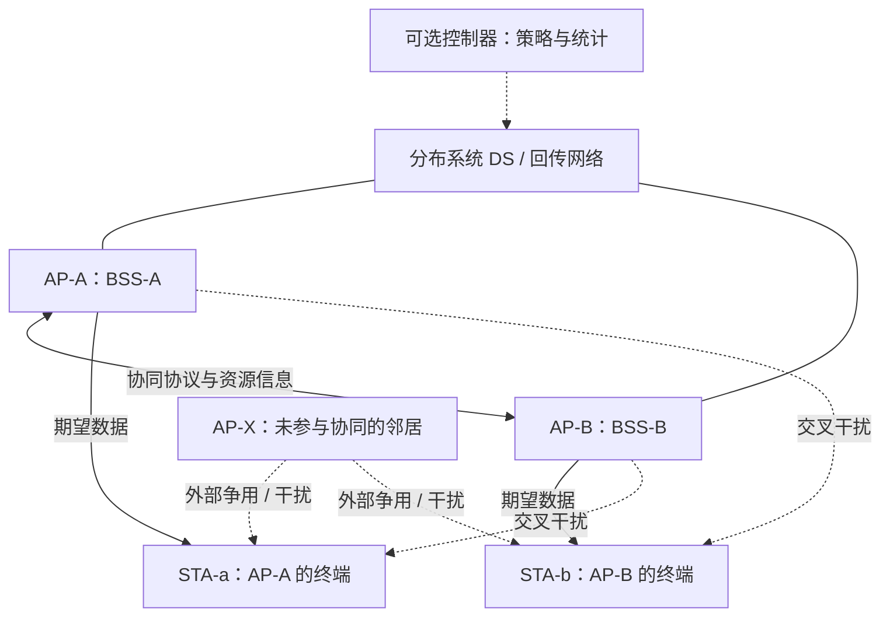
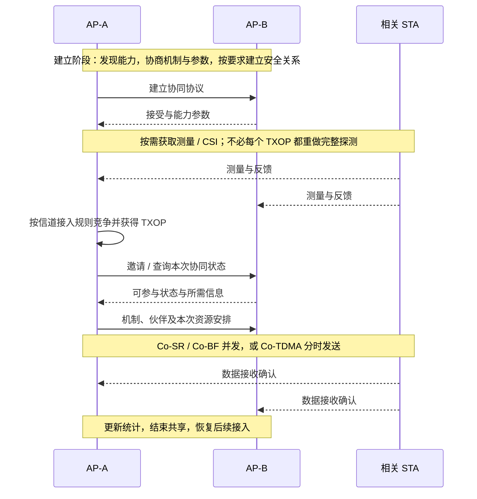
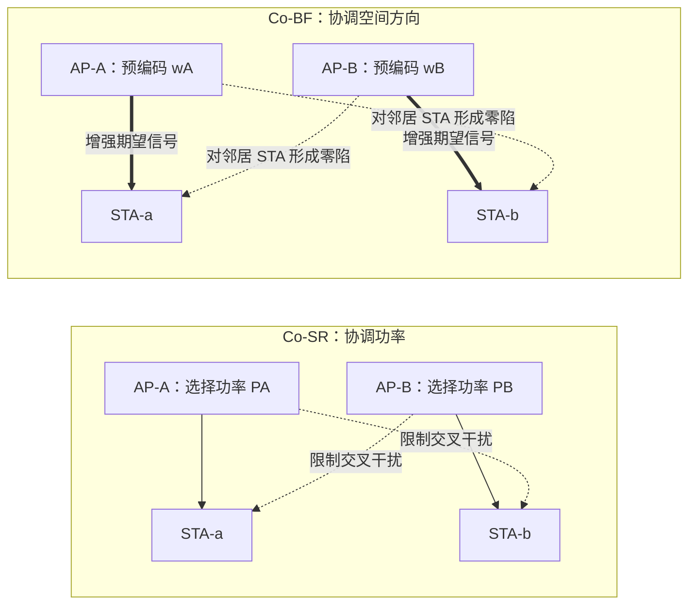
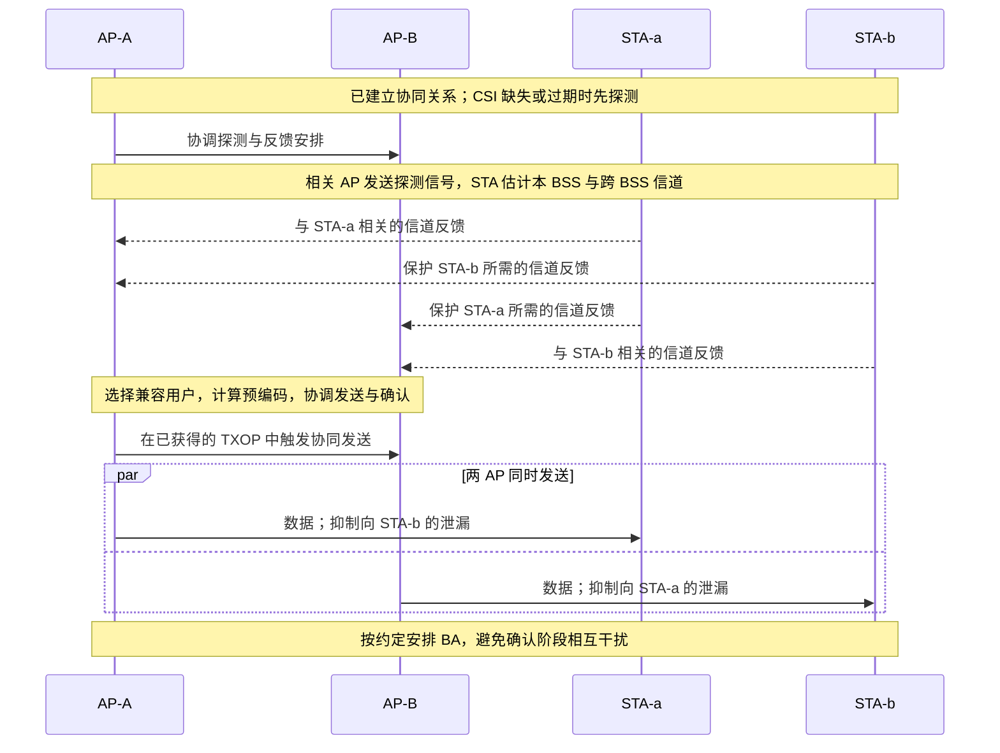
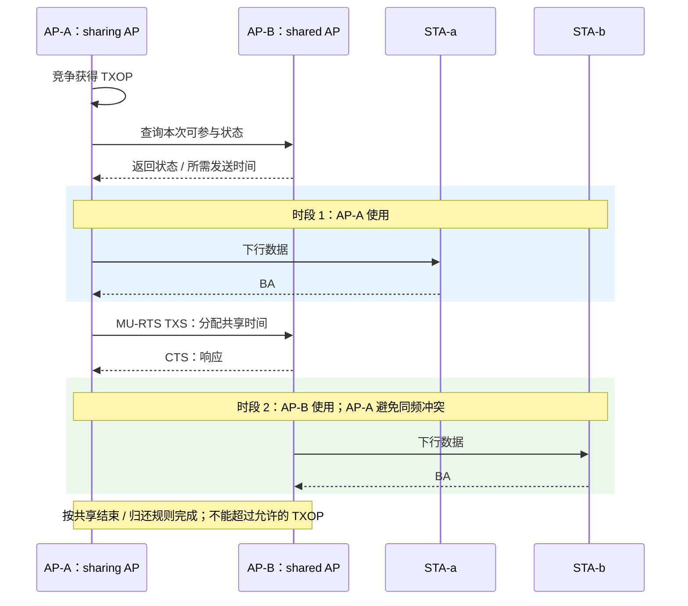
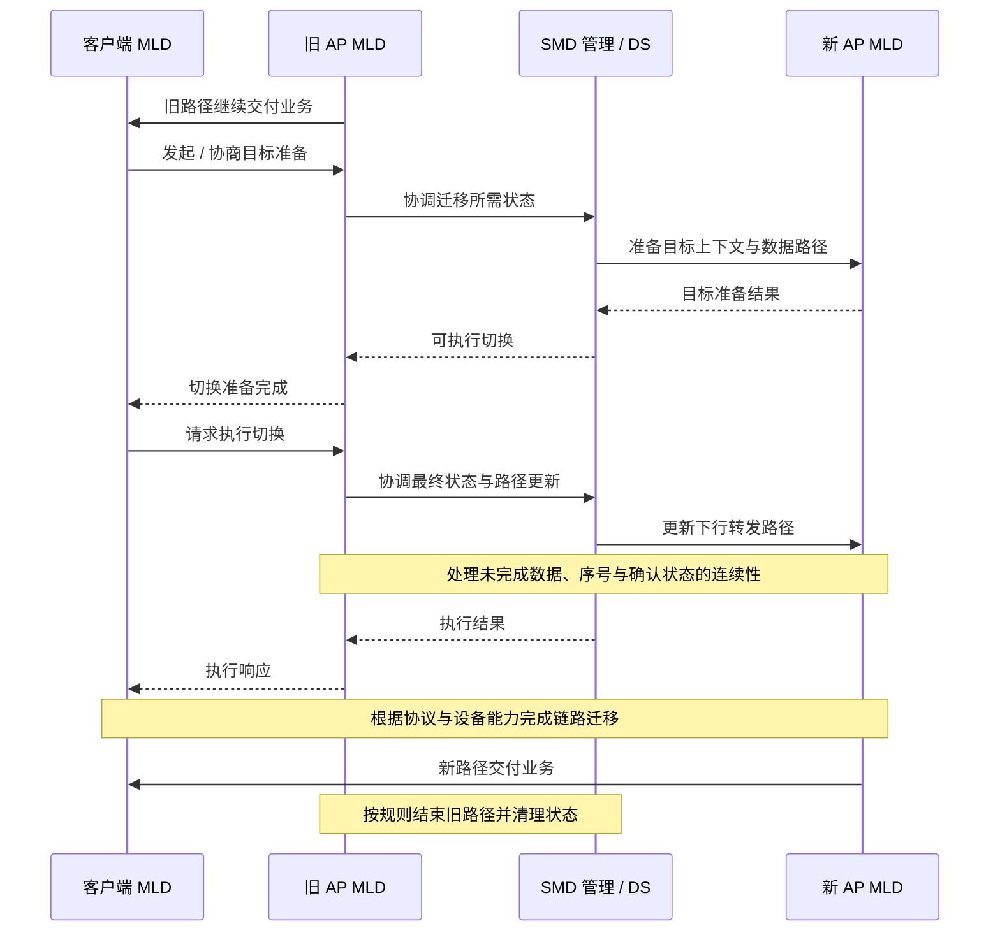
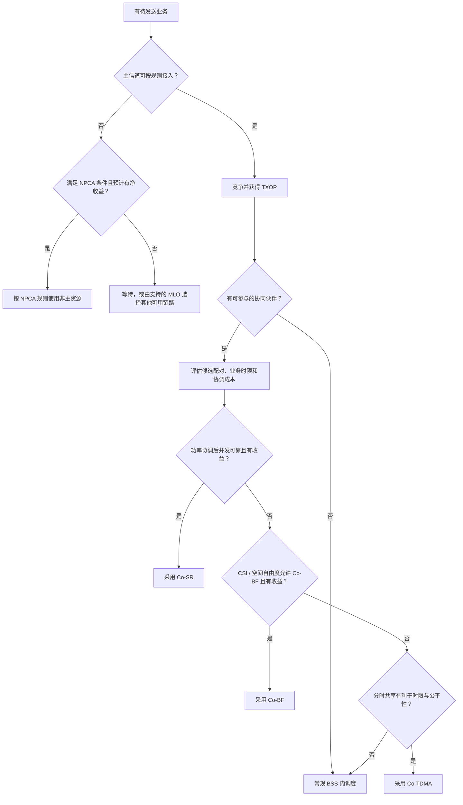

本文介绍Wi-Fi 8超高可靠性通信（UHR）关键技术与实现机制，首先简单介绍Wi-Fi 7在高密度接入、复杂干扰和移动切换场景下面临的问题，以及Wi-Fi 8（IEEE 802.11bn）的技术目标；重点讲解多AP协同通信机制，包括协同空间复用（Co-SR）、协同波束成形（Co-BF）和协同时分接入（Co-TDMA）的工作原理，以及AP之间如何进行资源协调、干扰控制和协同调度；进一步介绍非主信道接入（NPCA）、无缝漫游等技术对降低丢包率、尾部时延和通信中断的作用；结合典型网络拓扑图、通信时序图及性能对比，说明Wi-Fi 8相较Wi-Fi 7的技术改进。

*从一场偶尔卡顿的视频会议，看懂无线网络怎样变得更可靠。*

周一上午，小林正在会议室里开视频会。手机信号不错，刚才下载文件也很快。可屏幕另一端的同事刚讲到关键结论，画面就停住了。小林只听见：“我觉得这个方案最大的优点是……”

等网络恢复，小林已经开始猜优点是什么。

类似的卡顿，可能来自数据发出前的等待，也可能来自干扰，或者换接入点时的一次交接不顺。要找原因，光看一次测速还不够。我们得跟着一小段声音走一遍：**它怎样取得发送机会，怎样在干扰中被听清，又怎样在用户移动时继续送达。**

这正是 **UHR**（Ultra High Reliability，超高可靠性）关心的事：让数据更稳定、及时地送达，尤其减少那些拖很久、最后没送到，或在切换中断掉的数据。它不表示无线网络永远不会出错。

故事里有两台无线接入点，简称 **AP**（Access Point）：会议室的 AP-A 和工位区的 AP-B。它们负责给手机、电脑提供 Wi-Fi 接入；家用无线路由器通常也包含这一功能。隔壁公司还有一台 AP-X，后面它也会影响这场通话。

> **读这篇文章，不需要先背缩写。** 每个新术语会在出场时解释，文末另有速查表。公式前先讲具体例子；第一次阅读时，抓住公式旁的文字和图，就能跟上主线。办公室故事及未注明来源的数字都是教学假设，各节改变条件来说明不同机制，不代表一场通话必须依次启用所有技术。
>
> **资料核对日期：2026 年 10 月 24 日。** Wi-Fi 8 对应 IEEE 802.11bn，目前仍在制定。IEEE 是电气与电子工程师协会，802.11 系列规定无线局域网——家庭、办公室等局部范围内无线网络——的通信规则。标准进展、图示约定和来源说明放在文末，方便查证。

# 1. 测速很快，视频会议为什么还会卡？

## 1.1 数据发得快，也得先轮到它

想象一间热闹的会议室。每个人都能很快讲完一句话，可开口前要等别人说完；几个人抢着说、没听清，还得重来。提高说话速度能帮上一部分忙，排队和重说花掉的时间也得算进去。

无线通信也有类似的等待。声音、画面通常会拆成许多小块传送，这些小块叫**数据包**；按通信规则（也叫**协议**）打包后，会形成**帧**，用于承载业务内容或控制消息。等待发送的数据排成**队列**。我们关心两个不同的量：**吞吐量**是每秒实际成功交付多少数据，**时延**是数据从规定起点到终点花了多久。下载文件很快，并不保证每一小块语音都能准时到达。

Wi-Fi 7 已经有不少提高效率的办法。它对应 IEEE 802.11be，技术名称是 **EHT**（Extremely High Throughput，极高吞吐量）。下面四项能力，可以分别理解为扩大可用资源、让信号承载更多信息、利用多条连接，以及更灵活地分配资源。[Wi-Fi Alliance 官方发布稿][wfa7]

**多看一步：Wi-Fi 7 已有哪些本领。** 先看每项加粗的第一句话，就能理解它解决什么；后面的说明供想进一步了解的读者查阅。

- **320 MHz 信道：有更宽的频率资源可用。** 信道是设备使用的一段频率资源，有多宽就叫带宽。MHz 是兆赫，1 MHz 等于一百万赫兹，用来度量频率或频率范围；320 MHz 不是“每秒传 320 兆数据”。所讨论的频率资源合起来称为频谱。
- **4096-QAM：一次信号能表达更多信息。** QAM 是 Quadrature Amplitude Modulation（正交幅度调制），用信号强弱和相位的组合表示数据。相位可理解为波形在一次振动周期中所处的位置；一次用于表示数据的信号状态叫符号。4096 表示可区分的状态数量，状态更多也要求接收端分辨得更清楚。
- **MLO：手里可以有多条通信路径。** Multi-Link Operation（多链路操作）让设备选择、分配或并行利用多条链路；链路就是通信双方的一条无线连接。能否在不同链路上同时收发，要看设备能力。
- **多 RU 分配：频率资源可以分得更灵活。** RU 是 Resource Unit（资源单元），是从信道中划出的一小块频率资源。多 RU 分配允许同一终端，也就是手机、电脑等接入设备，使用多个这样的块。

MLO 本身就能帮助降低时延、改善可靠性。不过，信号传得更快，仍不能自动消除所有等待。这里常说的 **PHY 速率**，属于 Physical Layer（物理层）：这一层把数据变成无线信号，再把信号还原为数据。速率描述每秒可承载的数据位数量；数据位也叫比特（bit），就是一个 0 或 1。真正交付业务时，还要扣除控制消息、等待和重复发送等消耗。

回到小林的办公室：设备多了，大家要**争用**，即按规则竞争发送机会；信号互相影响时，接收可能失败；拿着手机换房间时，还得把维持连接所需的信息交给接手设备，这叫**状态迁移**。下面先给后续图里的几个角色和工具认个脸，不用急着记住英文拼写。

| 术语 | 通俗说明 |
|---|---|
| STA（Station，站点） | 本文特指手机、电脑等无线终端；在严格的标准用语中，AP 也属于站点的一种 |
| BSS（Basic Service Set，基本服务集） | 本文指一个 AP 及其服务的终端组成的无线服务组，可近似理解为一个 Wi-Fi 小区 |
| OFDMA（Orthogonal Frequency Division Multiple Access，正交频分多址） | 把频率资源划成小块，一次安排多个用户各用其中一部分 |
| MU-MIMO（Multi-User Multiple-Input Multiple-Output，多用户多输入多输出） | 利用多根天线区分不同用户的信号，在相同时间与频率资源上服务多个用户 |
| SINR（Signal-to-Interference-plus-Noise Ratio，信号与干扰加噪声比） | 想接收的信号，相对于其他发送造成的干扰和背景噪声有多强；不能只看手机上的信号格数判断 |
| 队列与数据包 | 信息通常拆成一个个数据包传送；等待发送的数据排成队列，来得比处理得快时就会积压 |

**调度**就是安排谁在什么时候、用哪些资源发送。有了这些名字，三类常见麻烦就能说清楚了：

| 典型场景 | Wi-Fi 7 网络仍可能遇到的问题 | 对业务的具体影响 |
|---|---|---|
| 高密度接入：较小范围内有很多 AP/终端，例如会议厅、体育场 | 同频（使用相同或重叠频率资源）的设备反复竞争；单个 AP 内的 OFDMA/MU-MIMO 调度无法独自解决邻居 BSS 的竞争；隐藏节点（彼此听不到，却可能干扰同一接收方的发送设备）可能同时发送 | 接入等待和队列积压，少量数据包等待特别久 |
| 复杂干扰：公寓、商场、工业现场 | 邻近 BSS 的信号互相影响，即交叉干扰；主信道是常规侦听和竞争所依据的指定频率部分，侦听就是先判断有没有其他设备在发送；主信道可能被占用，而其他部分仍空闲 | SINR 降低，引起速率回退（降低发送速率以争取可靠接收）、重传（未确认成功后再次发送） |
| 移动切换：语音终端、机器人、XR 设备；XR 为 Extended Reality，扩展现实，包括虚拟/增强现实等体验 | 扫描（寻找周围 AP）、目标选择、安全处理、数据路径迁移及重排序（恢复数据的原有先后顺序）可能落入关键业务时段 | 短时断流、排队突增、在途包（已发出但尚未完成交付的数据）丢失或乱序 |

Wi-Fi 7 也有应对办法。**BSS Coloring** 会给帧加逻辑标记，帮助区分本网络和邻居；**空间复用**允许互扰可接受的设备在不同位置同时使用相同频率资源。控制器，也就是统一管理多台 AP 的软件或设备，还能进一步优化安排。已有的 802.11k/v/r 分别涉及测量、网络管理和快速 BSS 转换，帮助寻找候选 AP、获得切换建议及加快连接转移。[IEEE 工作组概览][overview] [空间复用研究][power]

Wi-Fi 8 在这些基础上，进一步处理跨 AP 的配合和连接状态的接续。小林需要的结果很具体：关键半句话少等一会儿，换个房间也能听完对方的说明。

## 1.2 三个“25%”，分别照顾哪种体验

小林可能只会说“希望别卡”。工程师得把它拆成能测量的目标：每秒能送多少、慢包到底有多慢、最后有多少数据没送到。

IEEE 802.11bn 以 EHT MAC/PHY 操作为**基线**，也就是比较时采用的参考方案。**MAC** 是 Medium Access Control（介质访问控制层），负责共享信道的使用，以及确认、重传等。如果 PHY 关心“怎样把信号发出去”，MAC 就负责“谁何时发、如何确认收到”。目标覆盖孤立 BSS，也覆盖 **OBSS**（Overlapping BSSs，重叠 BSS），即覆盖或干扰范围相互重叠的 Wi-Fi 小区。[IEEE 项目授权范围][par]

| 指标 | 项目目标 | 阅读时必须保留的条件 |
|---|---|---|
| 吞吐量 | 提高 25% | 在至少一个 SINR 水平上，以 MAC 数据服务接入点的吞吐量衡量；这里的“服务接入点”是 MAC 向上层交付数据的逻辑接口，不是物理设备 AP |
| 尾部时延：关注等待特别久的那一部分数据 | 时延分布第 95 百分位降低 25% | P95 表示约 95% 的样本不超过该时延；不等于平均值、最大值，也不是保证每次都按时完成的硬实时上界 |
| MPDU 丢失 | 在给定场景中降低 25% | MPDU 是 MAC Protocol Data Unit（MAC 协议数据单元），可理解为加上链路控制信息的数据“信封”；它与应用程序看到的数据包不一定一一对应，不能直接等同应用层丢包率 |

读这张表时，给每个目标都带上一个条件：**存在至少一种符合要求的操作模式。** 它们不是对所有产品、所有业务负载（需要处理的业务量）的统一承诺，三种收益也不能直接相加。

把百分比换成具体数字，更容易看清。以下单位中，Mb/s 是每秒百万比特，ms 是毫秒，1,000 ms 等于 1 秒；大写 B 通常代表字节，1 字节等于 8 比特，所以 Mb/s 与 MB/s 不相同。分别假设三个满足比较条件的场景：

- **送得更多：** 吞吐量由 100 Mb/s 变为 125 Mb/s，提高 25%。
- **慢包少等：** 把 100 个包按时延从小到大排队，第 95 个由 40 ms 变为 30 ms，P95 就降低了 25%。本文使用最邻近秩法：样本数乘所求百分比，再将位置向上取整。最后几名仍可能等很久。
- **少丢一些：** 发送 10,000 个 MPDU，最终丢失由 100 个变为 75 个，丢失数量降低 25%；比例从 1% 变为 0.75%，相差的是 **0.25 个百分点**。

**图 1：把各自的参考值设为 100，看三个目标怎样变化。** 这种统一比例的表示叫归一化；每行独立比较，不是设备实测数据。

```text
                         EHT 基线                 UHR 目标示意
MAC 吞吐量（越大越好）    100  ####################  125  #########################
P95 时延（越小越好）      100  ####################   75  ###############
MPDU 丢失（越小越好）     100  ####################   75  ###############

每个 # 表示 5 个归一化单位；三行必须分别在符合目标定义的场景中评价。
```

# 2. 两台 AP 的配合，从一次资源协调开始

## 2.1 先看办公室里的几位“邻居”

会议室的 AP-A 给小林的手机传数据，工位区的 AP-B 服务同事的电脑。两台 AP 使用同一信道。房间有门，信号却不会恰好在门口停下：A 的发送可能影响 B 的终端，B 也可能影响小林。

视频通话有两个方向：AP 向终端发送叫**下行**，终端向 AP 发送叫**上行**。下面的 Co-SR、Co-BF 示例按所引草案说明演示下行，跟着远端声音从 AP 到达小林手机；小林开口说话时的上行数据，需要遵守相应的上行接入规则。[公开 MAPC 技术说明][mapc-perf]

这就有了**多 AP 协同**，简称 **MAPC**（Multi-Access Point Coordination）：多个接入点交换必要信息，协调无线资源的使用。先看一张**网络拓扑图**，也就是“谁与谁连接、谁会影响谁”的关系图。

一个 AP 与其关联终端构成 BSS；**关联**是终端与接入网络建立正式服务关系。图中的 **DS** 是 Distribution System（分布系统），负责连接 AP 与网络其他部分；**回传网络**是 AP 通往后端网络的连接，可以有线，也可以无线。

**图 2：会议室 AP-A、工位区 AP-B，以及隔壁 AP-X。** 实线中的“期望数据”是终端想收到的本 AP 数据；虚线标出可能妨碍接收的交叉干扰。AP-X 没有加入协同。



合作之后，小林的数据仍由 A 发送，同事的数据仍由 B 发送。改变的是两台 AP 如何使用**空口**——设备通过无线电交互的这一部分。它们可以通过空口或分布系统交换信息；集中控制器、有线回传和共享用户数据，并非下面三种机制统一的必选前提。[跨 AP 时间共享研究][tdma] [MaxLinear 技术白皮书][maxlinear]

后文主要用一个 **AP 对**，即一对 AP，解释协同。楼里可以有很多 AP，但“有多少台设备”“哪些设备建立了合作关系”“这一次有几台并发，也就是同时发送”，是三个不同问题。不能把大网络直接理解为所有 AP 在同一时刻联合发送。

## 2.2 调功率、调空间响应，或者分时间

两台 AP 想减少互相影响，大致有三种选择。看表前只需再认识 **TXOP**（Transmission Opportunity，发送机会）：一段按规则取得、可以安排发送的时间，不一定是提前固定预约的时段。

下面的**同一时频资源**，指同一时间使用同一段频率；**发射功率**可以先理解为发出信号的强弱。

| 机制 | 主要协调变量 | 同一时频资源上能否同时发送？ | 最适合解决的问题 |
|---|---|---|---|
| Co-SR：Coordinated Spatial Reuse，协同空间复用 | 发射功率、干扰容限（接收方能承受的额外干扰）、参与的 AP–STA 配对 | 可以，商量好功率后一起发 | 原本过度退让，或缺乏功率协调而无法可靠并发 |
| Co-BF：Coordinated Beamforming，协同波束成形，即让多天线配合改变信号在不同位置的强弱 | 信道信息、预编码权重（发送前对各天线强弱与相位所作调整的数值）、需保护的邻居终端 | 可以，通过空间零陷（让特定接收位置的信号尽量弱）降低交叉干扰 | 单纯调功率难以兼顾两条链路，但空间传播特征可以区分 |
| Co-TDMA：Coordinated Time Division Multiple Access，协同时分接入 | TXOP 内的时间分配、执行顺序、共享时长 | 分享已获得的时间，按顺序轮流发 | 并发不合适，但重复竞争导致接入时延不稳定 |

先记动作就够了：Co-SR 协调功率，Co-BF 调整不同接收位置的效果，Co-TDMA 分配时间。后面三节会把这三种办法各演示一遍。

取得 TXOP 并发起共享的一方称为 **sharing/coordinating AP**（共享发起方/协调方）；接受共享的一方称为 **shared/coordinated AP**（接受共享的一方/被协调方）。它们是这次操作中的角色。**Mesh** 是多个节点互联协作、扩展覆盖的组网方式，其中常说的“主路由器”“子路由器”，不能直接代入这里的角色。

## 2.3 一次协调，要把哪些事情说清楚

假设 AP-A 刚拿到发送机会。它需要确认：伙伴有没有待发数据，这段时间还够不够，同时发送会不会互相影响，以及接收方怎样报告结果。实际设备交换的是协议规定的字段，即按约定格式填写的一项项信息。

整个过程分两层：先发现对方能力、建立合作规则；之后每次取得 TXOP，再确定这次和谁配合、分多少资源。常用信息如下，具体字段不必每次都全部交换。

| 信息类别 | 典型内容 | 服务于什么决策 |
|---|---|---|
| 能力与协议 | 支持的协同机制、信道、带宽、伙伴身份 | 双方是否可以协作，采用何种操作 |
| 链路与干扰 | 接收功率、可接受干扰、目标 STA；Co-BF 还需要 CSI（Channel State Information，信道状态信息，描述信号传播后怎样变弱、改变相位等） | 能否并发、怎样调功率或配置零陷 |
| 业务需求 | 队列状态、业务优先级、所需空口时间 | 谁先发送、共享多少时间；具体调度策略由实现选择 |
| 执行约束 | 可用 TXOP 时间、起止时刻、反馈与保护安排 | 保证数据和确认均落入允许的资源范围 |
| 运行反馈 | BA（Block Acknowledgment，块确认，一次反馈多个帧的接收情况）、重传结果、实际时延、信息新鲜度 | 下一次继续协同、调整参数或回退 |

其中，CSI 里的“信道”着重描述信号传播条件，不只是频率编号。获取它通常要做**探测**：发送已知信号，测一测到接收端后发生了什么变化；再做**反馈**，把结果报告给需要作决策的设备。BA 则像一张收货清单，告诉发送方哪些帧已经收到。

**图 3：先建立合作，再安排一次发送。** 图中的“状态/安排”是抽象消息名，不同机制采用不同帧交换。读图时顺着箭头向下看即可。



合作仍有边界。整个 **WLAN**（Wireless Local Area Network，无线局域网，例如家庭或办公室里的无线网络）依然存在竞争接入；A、B 通常要先取得合法发送机会，也无法替隔壁的 X 安排时间。它们还需要**介质保护**，即用控制消息等保护当前交换，并给其他设备留下合理的使用机会。[Co-TDMA 原创研究][tdma]

# 3. Co-SR：音量合适，两边就有机会一起说

## 3.1 自己听得清，也少打扰邻居

先让小林靠近 AP-A，同事也靠近 AP-B。这时，两条链路是否非得一前一后发送？如果各自接收端都能听清，就值得评估同时发送的可能。

可以想想相邻两桌人聊天。每桌的人都坐得近，双方不必扯着嗓子说话；用合适音量，同桌听得清，邻桌受到的影响也较小。但若本桌有人坐得很远，声音一降，他也听不清了。**功率要同时照顾自己的接收方和邻居，不能一味调低。**

Co-SR 做的就是这种功率协调。以 AP-A→STA-a、AP-B→STA-b 为例，箭头表示发送方向：完全串行，也就是只能先后发送，有时会浪费机会；双方都用过高功率，又可能使两端接收失败。它需要寻找能兼顾两端的配置。

Wi-Fi 已有 **OBSS/PD**，即对其他 BSS 无线发送的检测，PD 是 Packet Detection。相关空间复用机制会结合邻居信号强弱等条件，判断是否还能发送。Co-SR 在此基础上增加跨 AP 的协调信息，让配对与功率安排更有依据。[Co-SR 功率分配研究][power]

## 3.2 多看一步：一个功率值，要同时过两关

先做一道不用公式的题。固定 AP-A 的功率后，假设 AP-B **至少用 3 个功率单位**才能服务自己的终端；为了保护小林的接收，**最多只能用 5 个单位**。3～5 之间便有可行选择。

现在同事移远了，B 至少得用 7 个单位，A 那边却仍只允许它用到 5。此时找不到合适功率。取中间的 6 也没用：对自己不够，对邻居又太强。系统需要换终端配对、调整速率或功率，或者改为分时发送。

下面的双链路模型，就是把这两关写得更精确；它是教学模型，不是标准规定的唯一算法。

- $P_A,P_B$ 是两个 AP 的**线性发射功率**，即可直接用于乘除计算的功率数值。
- $g_{Aa}$ 是 AP-A 到 STA-a 的**功率增益**，即接收功率与发射功率的比例，可以远小于 1。下标第一个字母是发送 AP，第二个是接收终端，因此 $g_{Ba}$ 表示 B 对 a 的交叉传播关系，$g_{Bb}$、$g_{Ab}$ 同理。
- $N_a,N_b$ 是两端背景噪声及模型计入的其他干扰功率。

$$
\mathrm{SINR}_a=\frac{P_Ag_{Aa}}{N_a+P_Bg_{Ba}},\qquad
\mathrm{SINR}_b=\frac{P_Bg_{Bb}}{N_b+P_Ag_{Ab}}.
$$

分子是想收到的信号，分母是噪声与另一 AP 带来的干扰。假设两端所需的最低目标 SINR，也就是**门限**，分别为 $\gamma_a,\gamma_b$；满足它们，是模型中正确**解码**（从信号还原数据）的要求。固定 $P_A$ 后，B 的功率范围为：

$$
\underbrace{\frac{\gamma_b(N_b+P_Ag_{Ab})}{g_{Bb}}}_{\text{保证 STA-b 解码所需的下限}}
\le P_B \le
\underbrace{\frac{P_Ag_{Aa}/\gamma_a-N_a}{g_{Ba}}}_{\text{保护 STA-a 所允许的上限}}.
$$

左边是“自己听得清”的下限，右边是“邻居还能正常接收”的上限。当下限大于上限，或上限为负，就没有可行配置；同时还要满足设备功率限制。

这个模型忽略了具体接收机、**衰落**（接收强弱随移动、遮挡等变化）与门限误差，因此实际部署还应留**裕量**，给不确定性留些余地。常见功率单位 **dBm** 是相对于 1 毫瓦的对数单位，0 dBm 等于 1 毫瓦；它不能直接代入上面的线性公式。

## 3.3 真正发送前，还要做四件事

1. **看接收端的位置和测量结果。** AP 彼此离得远，不代表它们不会干扰对方终端。
2. **定下保护要求。** 确认本次参与者、允许功率和时长，找出双方可接受的配置。
3. **安排并发和接收确认。** 即使单条链路降了速，也要看两条链路合起来是否更有效；协调、确认花掉的额外时间与资源，叫作**开销**，也得一起计算。
4. **用实际结果修正。** 小林走动、有人关门或外部干扰变化后，原先合适的配对可能就不合适了。

**图 4：Co-SR 主要调功率，下一节的 Co-BF 还会调整空间响应。** PA/PB 是两台 AP 的发射功率，wA/wB 是调整多天线输出所用的权重。



设备交换安排通信的控制消息，称为**信令**。现有协同信令并不表示每个 AP 都掌握了全网的**信道矩阵**——把多天线、多链路传播关系排成的数字表。2026 年研究指出，某些兼顾公平性的功率优化策略，还需要新增逐 TXOP 信道报告；这些应当作为研究或实现选择理解。[功率分配与信令边界][power]

如果功率怎么调都难以兼顾两端，就轮到多根天线提供另一种帮助了。


# 4. Co-BF：让不同位置，收到不同的效果

## 4.1 多根天线，不只是把声音一起放大

假设小林坐到了一个不太理想的位置。AP-B 降低功率，小林受到的干扰少了，同事却也收不清。只调总功率，已经很难两头兼顾。

可以想象两组人各用一套可调扬声器，希望本组听得清、另一组少受影响。多个扬声器改变各自输出的强弱和相位后，声音在不同位置的叠加效果会变化；经过合适调整，可以让本组听众处较强、另一组听众处较弱。无线里的多根天线，也能通过配合改变不同接收位置的效果。

普通波束成形着重增强本 AP 到目标终端的信号。Co-BF 还把邻居需要保护的终端算进来：A 向小林发送时，尽量压低落到同事终端的**泄漏**，即原本发给别人、却在这里形成干扰的信号；B 也做相应处理。一组配合工作的天线叫**天线阵列**，它们通过预编码形成的低响应区域就是**零陷**。[跨 BSS 零陷研究][bf-null]

办公室有墙壁、家具和走动的人。信号会经直达、反射等多条路径到达，这叫**多径**。因此，Co-BF 的工作比“把天线朝手机转过去”复杂得多；它需要知道传播条件，再计算各根天线该怎样输出。

**多看一步：公式只表达两个要求。** 先考虑一路独立数据，也就是**单流**。对各天线信号按权重作乘法和叠加，称为**线性预编码**。希望达到的效果是：

$$
|\mathbf h_{Aa}^{H}\mathbf w_A|^2\ \text{保持足够大},\qquad
|\mathbf h_{Ab}^{H}\mathbf w_A|^2\ \text{尽量小}.
$$

第一项对应本 AP 的目标终端，第二项对应要保护的邻居终端。$\mathbf h$ 是**复数信道向量**，即同时记录信号衰减与相位变化的一组数；$\mathbf w_A$ 是 A 的发射权重。$H$ 表示**共轭转置**，是组合信道与权重时使用的数学运算。竖线表示取幅度，外面的平方衡量信号强弱。

理想的**零迫设计**会尝试用数学约束让第二项为零。实际系统存在测量、移动和硬件误差，所以这里的零应理解为理想目标，不能当作“邻居从此完全听不到干扰”的保证。

## 4.2 小林挪了座位，旧设置还管用吗

回到扬声器的例子：先播放测试声音，让不同位置的听众报告效果，再调整输出。若听众换了座位，原设置就可能失准。

无线系统也要通过探测和反馈获得 CSI。它既要覆盖自己终端的链路，也要覆盖需要保护的邻居链路。**只测清楚“我到小林”的信道，并不足以准确保护旁边同事的终端。** 有了相关信息，AP 才能选择合适的终端组合并计算预编码。

**图 5：先了解传播条件，再协调并发。** 探测结果可以供多个后续发送使用；图中箭头表示信息到达，不要求每份 CSI 都由独立帧直接发送。



测量也花时间。如果每播放一小段内容，就要停下来长时间校准，整体未必更快。业务很少、移动很快或 CSI 反馈很大时，探测和反馈的成本可能超过并发收益。研究者提出过用**自编码器**——一种学习如何压缩并恢复信息的算法模型——减小反馈量；这里把它作为进一步研究介绍，不列为 Wi-Fi 8 标准必选功能。[探测、反馈与开销研究][bf-csi]

还有一个限制：一组天线可以独立调整的条件有限。这种余地叫**空间自由度**。要保护的独立信道越多，留给数据流与**阵列增益**（多天线配合带来的信号增强）的能力就越少。如果小林和同事的传播特征太相似，即信道**高度相关**，压低同事那里的干扰，也可能连小林想要的信号一起压低。

所以，一次成功的 Co-BF 需要合适的配对、足够新的 CSI，以及协调好的**前导**、数据发送和确认过程。前导是数据前的一段已知信号，帮助接收端识别发送、对准时间和估计信道。[空间自由度研究][bf-null]

最后分清一个相近名字：**JT**（Joint Transmission，联合传输）可以涉及多个 AP 向同一终端发送。本文的 Co-BF 中，A、B 各发各的数据，只协调干扰抑制；它不要求共享用户数据，也不要求对同一份数据做**相干合成**，即精确配合相位后在接收端叠加，更不据此要求不同 AP 的发射相位严格锁定。

# 5. Co-TDMA：轮流说，也能少等很久

## 5.1 拿到发送机会后，分一段给伙伴

有些位置关系下，同时发送仍不划算。此时 AP-A 刚取得 TXOP，而 AP-B 有一份急需发送的数据：如果规则允许，A 可以把这段机会的一部分分给 B。

这像会议上甲取得 30 秒发言时间，先讲自己的内容，再把允许分享的一小段交给乙。乙接着讲，无须等甲结束后重新举手竞争。这里的 30 秒只是生活类比；无线系统使用的具体时长由协议决定。

Co-TDMA 的工作方式正是**在已经取得的机会内，按顺序分配时间**。B 在获分配的时间内服务自己的 BSS，省去这部分传输重新独立竞争的过程。它不需要跨 BSS 的精细 CSI；收益来自安排得更好，不能仅靠分时就把频谱容量翻倍。[Co-TDMA 机制研究][tdma]

共享仍要按规则来。公开的 D1.4 技术说明要求伙伴具有相同主 20 MHz 信道、工作带宽重叠；D 表示 Draft，即草案版本。还有**接入类别 AC**（Access Category）的约束：语音、视频等业务具有不同接入优先级，不能把高优先级取得的机会任意转给更低优先级业务。实现时需核对采用的草案规则。[公开 MAPC 技术说明，第 IV-C/IV-F 节][mapc-perf]

**图 6：A 先发，B 接着发，确认也留在时间安排里。** 图中下行是 AP→终端，上行是终端→AP。MU-RTS TXS 是通告共享安排的触发帧，即通知对方按指定安排操作的控制消息；MU-RTS 表示多用户请求发送，TXS 表示触发式 TXOP 共享。CTS（Clear to Send，允许发送）是相应响应，BA 报告接收情况。具体字段与规则以草案为准。



这幅图选择下行演示。机制和设备能力允许时，得到共享时间的 AP 也能组织本 BSS 的上行交换。这里分的是跨 AP 的时间，与单个 AP 内的 OFDMA 资源分配需要区分。

## 5.2 等了 18 ms 的包，最需要哪种帮助

假设一个包等待 18 ms，真正发送只花 2 ms，总共 20 ms。把发送速度翻倍，发送只剩 1 ms，总耗时仍有 19 ms。

如果共享发送机会把等待缩短到 5 ms，哪怕发送还要 2 ms，总共也只需 7 ms。这个教学算例说明：**对于大部分时间都在等的包，减少等待很有价值。** 它不是 Co-TDMA 的固定性能承诺。

把一次成功交付的无线侧耗时拆开，大致可以写成：

$$
D = D_{\mathrm{queue}} + D_{\mathrm{access}}
  + D_{\mathrm{tx}} + D_{\mathrm{retransmission}}.
$$

四项依次是排队（queue）、竞争接入（access）、实际发送（tx）和重传（retransmission）的耗时。它是解释用分解，统计时应避免把重传中的接入时间重复算两遍。

Co-TDMA 主要影响随机接入等待。设备争用时会**退避**，即按规则随机等一段时间再尝试；伙伴分享的机会，可以减少某些反复等待。但 A 让出时间后，自己的队列也可能变长。查询、授权又有开销；大家都忙到每次用满 TXOP 时，可分的时间也少。

好的调度要兼顾业务时限、负载和公平性，并遵守对其他 AP 的共存规则。Wi-Fi 使用的**非授权频段**，是无需给每个用户分配专用频率许可、但仍须遵守规则的频率范围；Co-TDMA 无法为整个频段提供每次必准时的硬实时保证。[Co-TDMA 原创研究][tdma] [住宅部署与兼容性分析][maxlinear]

# 6. NPCA：主信道忙时，利用约定的空闲部分

## 6.1 看着有空位，为什么还不能直接发

换一种情况：隔壁 AP-X 正占用主信道所在的部分频谱，办公室这边其他频率却还空着。小林的数据可能得继续等，因为传统宽带接入以主 20 MHz 信道为重要**锚点**，也就是共同约定的侦听和竞争基准。宽信道中较小的一段叫**子信道**；有空闲子信道，并不自动意味着可以绕过主信道发起常规接入。

**NPCA**（Non-Primary Channel Access，非主信道接入）就针对这种机会：双方在满足条件时，临时到预先约定的非主资源上接入，完成交换后按规则返回。使用的仍是同一工作信道范围内的资源。[MediaTek NPCA 技术说明][mtk-npca]

可以想象小林与同事平时在固定会谈室碰面。今天那里被占用，但两人事先约好的备用房间空着，就临时过去交流。双方必须知道去哪里、确认对方也到了，还得留出返回时间。若只有小林换了房间，同事仍在原处等，空房间再多也聊不成。

这里的房间代表频率资源，“换房间”对应设备切换到约定的非主资源，用户可以坐在原处。下一节才会讨论用户真的走进另一个房间时的连接交接。

**图 7：主信道忙着，约定的非主资源仍有可用窗口。** 假设总带宽为 80 MHz，C0～C3 是本文给四个 20 MHz 子信道起的编号，不是协议字段名；可用组合要符合设备和接入规则。

```text
频率子信道        频谱状态 / 用途
C3                空闲，可与 C2 组成示意中的 40 MHz 发送带宽
C2                空闲，预先约定为 NPCA 接入锚点
C1                空闲，但本例未使用
C0（原主 20 MHz） 被 OBSS 占用

时间 →       检测 / 判断   切换     侦听与接入      数据与确认    回切
C0           |------------------ OBSS 持续占用 ------------------|
C2～C3                    |开销|----等待----|====发送====|开销|

示意条件：有足够的剩余占用时间，且 C2～C3 满足访问和带宽规则。
```

## 6.2 一次临时转移，要把来回的时间算进去

实现 NPCA 时，可以顺着五个步骤看：

1. **先约好去哪。** AP 与支持 NPCA 的 STA 提前配置非主接入信道、切换条件及参数。
2. **确认有值得利用的窗口。** 根据可识别的 OBSS 占用、带宽与剩余时间作判断，无法解码的干扰不能直接当作已知窗口。
3. **切到约定资源。** **单射频设备**在本文指一套可切换配置的无线电收发装置，切换需要时间，切走时对原信道的监听也受限制；它不等于只有一根天线。
4. **按规则接入，并确认接收方就绪。** **CCA**（Clear Channel Assessment，空闲信道评估）负责侦听和判断忙闲；仍须遵守退避、保护等规则，并通过适用的初始控制/响应交换确认接收方已准备好。自己听到空闲，不代表接收方已经切过来。
5. **发完、确认，并及时回去。** 数据、确认与回切都要放进允许的窗口，尤其要考虑接收方的回切时刻；漏听、隐藏节点和双方忙闲判断不同，都可能减少收益。[NPCA 设计研究][npca-design] [IEEE 回切讨论][npca-timer]

算一笔时间账：假设窗口还剩 5 ms，切出与切回合计 0.4 ms，预计接入和控制交换 0.6 ms，数据与确认 2 ms，一共 3 ms，尚有余量。如果窗口只剩 0.8 ms，这次交换就放不下。

实际接入等待具有随机性，所以预算不是成功保证；等待过久要按规则停止尝试并返回。对单射频实现，“窗口应容纳切换、接入、数据、确认和回切”是直观的收益判断，不是某个最终标准门限的精确定义。

## 6.3 打孔、MLO、NPCA，各有各的适用情形

这三个名字都与利用资源有关，容易看成同一种办法。分清当前遇到的限制，就好理解了：

| 技术 | 解决问题的主要方式 | 不能混同之处 |
|---|---|---|
| 前导打孔（Preamble Puncturing） | 在允许的宽带发送中，按规则暂不使用某些子信道；“打孔”是比喻，不是物理开孔 | 不等于主信道忙时可以任意改用非主信道发起接入 |
| MLO | 在多链路设备建立的链路之间利用资源，分流（将不同数据分配到不同链路）或选择发送路径 | 另一条链路是独立配置的链路，不只是当前信道的一个空闲子块 |
| NPCA | 在符合条件的主信道阻塞期间，临时使用约定的非主接入资源 | 仍有接入与切换成本，不是新增频谱，也不自动消除其他干扰 |

比如，主信道能接入，只是某些非主子信道受干扰，可以考虑符合规则的打孔组合；已经建立另一条可用链路，可以由 MLO 利用；当前主信道忙、约定的非主资源还有窗口，才是 NPCA 针对的机会。设备是否支持这些操作，还要看具体能力。

Wi-Fi 7 的 MLO 和打孔已能缓解部分**拥塞**（业务太多，处理不过来）与**频谱碎片**问题（可用频率被占用部分隔成不连续小块）。NPCA 进一步利用特定接入条件下留下的空闲资源。[Qualcomm Wi-Fi 7 技术说明][q7] [MediaTek NPCA 白皮书][mtk-npca]

对于小林，可能的好处是少等主信道恢复。队列更早得到服务，也有机会少一些**缓存溢出**——等待数据超过临时存储容量，或**超时丢弃**——等得太久而不再满足要求。它并不提高相同 SINR 下的**纠错能力**，即利用附加信息恢复受损数据的能力；如果额外接入带来更多**碰撞**（发送相互干扰导致接收失败），结果也可能变差。

# 7. 无缝漫游：小林换了房间，通话怎样接下去

## 7.1 接手的 AP，先知道业务办到了哪一步

会议还没结束，小林拿着手机走向工位区。连接从一个 AP 转到另一个 AP，叫作**漫游**。此时不只要找更合适的信号，还得处理三件事：新 AP 准备好了没有，哪些数据已经送达，后续数据该往哪里送。

这很像客服转接。每换一个人，都要从身份和问题重新讲起，转接自然费时。更顺畅的交接是：原客服仍在服务，下一位先了解必要资料；正式接手时，再核对最新进度。

无线通信中，这组用于接着办事的信息叫**上下文**。其中，身份验证、密钥及安全处理有关的部分是**安全上下文**；**密钥**是加密、解密等操作所需的秘密参数。

802.11k/v/r 已能帮助寻找邻居、接受网络引导和加快 BSS 转换。Wi-Fi 8 的 **SMD**（Seamless Mobility Domain，无缝移动域）进一步维护关联与安全上下文的连续性：它是共享相应移动性管理的一组设备构成的逻辑范围，目标是减少关键切换时刻的重复建立工作。部分厂商材料使用 Single Mobility Domain 的名称，本文统一采用 Seamless Mobility Domain。[IEEE 既有技术概览][overview] [MediaTek SMD 说明][mtk-smd] [Qualcomm SMD 说明][q8]

**再认识三个架构角色，就能读下一幅图。** **MLD** 是 Multi-Link Device（多链路设备），能够以统一设备身份管理多条链路；**non-AP MLD** 是本文手机等客户端一侧，**AP MLD** 则是接入点一侧。**SMD-ME**（Seamless Mobility Domain Management Entity，无缝移动域管理实体）负责协调域内连接与移动状态，是逻辑角色，不必单独占一台物理控制器。

客户端在同域 AP MLD 之间迁移时，可以保留 SMD 层关联。公开架构有两种安排：各 AP MLD 使用独立 MAC 服务接入点，或整个 SMD 共用一个。这些“服务接入点”仍是交付数据的逻辑接口。[MediaTek 白皮书，第 10—12 页][mtk-smd]

手机列表里的网络名称叫 **SSID**（Service Set Identifier，服务集标识）。两个 AP 名字一样，只说明这一项名称相同；要接续上述状态，还需要 AP、终端、分布系统与安全配置共同支持。

## 7.2 先准备，再正式交班

**准备阶段：能提前办的，趁旧连接还在时办。** 手机仍通过会议室 AP 通信，同时发现候选 AP，处理工位区目标侧的能力、连接与状态准备，尽量减少实际断流窗口里的工作。

**执行阶段：核对进度，把路径接过去。** 目标准备妥当后，处理旧 AP 的未完成发送与在途数据，更新路径，再按规则结束旧路径。有相应多链路/射频能力的方案可以先建新路径再释放旧路径；单射频设备不会因此获得同时保持两条物理接收路径的能力。

**图 8：一次“经当前 AP 执行切换”的示意。** 注意准备完成后，还有执行请求与响应。SMD 管理与 DS 画在一起只是为了好读，不要求部署在同一设备，也不承诺所有硬件都能零中断。



交班清单里，至少有以下几类问题：

- **没办完的还剩多少？** 旧 AP 队列中的帧要有处理办法。临时存放数据的空间叫缓存，但接续业务不意味着把所有缓存复制给所有 AP。
- **哪些已收到，哪些还在等？** **SN**（Sequence Number，序号）为帧标记顺序；**Block ACK 窗口**是当前追踪的一段序号范围。它们帮助接上确认进度，减少漏交、重复和顺序混乱。
- **安全检查怎样接续？** **PN**（Packet Number，分组号）是无线加密处理中使用的计数值，有助于识别旧数据冒充新数据的重放行为。它与普通排序用的 SN 作用不同，PN 和密钥上下文都要按适用协议维护。
- **新来的数据送到哪？** 分布系统需要及时改变转发目标，避免手机已经过去，数据还不断送向旧 AP。

具体做法依草案、安全模式和实现而定。上述清单不要求所有产品复制全部密钥、缓存，或把全部数据同时发两遍。[MediaTek 状态迁移说明][mtk-smd] [IEEE 安全上下文讨论][smd-security]

## 7.3 信号接上了，业务也要跟上

小林最容易察觉的是“刚才有没有断音”。背后几项工作的作用，可以分别看：

| 改进环节 | 对丢包的作用 | 对尾部时延和中断的作用 |
|---|---|---|
| 提前准备目标侧状态 | 降低旧链路恶化后仍无可用目标的风险 | 缩短实际切换时需要完成的工作 |
| 有序迁移数据和确认状态 | 减少在途帧遗失、错误重复或重排序异常 | 减少业务等待重传、重排序恢复的尖峰 |
| 及时更新分布系统转发 | 减少下行继续送往旧 AP 的情况 | 缩短已切换无线链路但业务仍未恢复的空档 |
| 配合支持的多链路能力 | 在条件允许时维持可用业务路径 | 有机会进一步缩短感知中断，但取决于射频和协议能力 |

测试时应分别记录无线切换耗时、应用能看到的最大无包间隔（最长有多久收不到包），以及切换附近的丢包率。**端到端**指从发送应用一直到接收应用的整个路径；无线关联完成，只完成了其中一部分。

**IP**（Internet Protocol，网际协议）负责让数据包在网络之间传递，IP 地址标识通信接口；跨网段移动可能涉及地址变化。视频通话等应用持续维持的通信叫**会话**。地址变化、会话迁移，或者工位区根本没有可用覆盖，仍可能阻碍恢复。提前交班很有用，但它不能凭空补上缺失的无线信号。


# 8. 数字看起来很好，体验真的更好吗

## 8.1 先看一个容易把人骗过去的成绩单

小林试用两套网络，记录了各 100 个包的结果。这里继续使用教学假设：

- 网络甲：90 个包花了 10 ms，另外 10 个花了 100 ms，全部送达。
- 网络乙：前面 90 个也是 10 ms，后面 10 个却全部丢失。

如果只统计收到的包，按前文的最邻近秩法计算，乙的 P95 是 10 ms，甲却是 100 ms。乙的数字看起来更漂亮，代价是 10% 的包根本没到。

因此，评估可靠性要把**时延、丢失和业务超时放在一起看**。那些最慢的数据若被丢弃，就从“成功送达包的时延表”里消失了；平均值或某个分位数变好，并不一定代表通话更顺畅。

再看 Wi-Fi 7 与本文 Wi-Fi 8 机制的对照，就会发现每种改进处理的问题并不一样：

| 维度 | Wi-Fi 7 已有基础 | Wi-Fi 8 本文所述增量 | 预期改善及条件 |
|---|---|---|---|
| 跨 BSS 空间复用 | 既有空间复用、信道侦听和功率相关规则 | Co-SR 显式协调伙伴与功率/干扰约束 | 兼容配对可减少不必要等待；不适合的几何关系不能强行并发 |
| 跨 BSS 空间干扰 | 波束成形与 MU-MIMO 等能力 | Co-BF 获取相关跨 BSS CSI，保护邻居接收端 | 提高并发成功率；受空间自由度、CSI 误差与开销限制 |
| 跨 AP 接入 | AP 内调度及各类 TXOP 使用机制 | Co-TDMA 向邻居 AP 分配已获得的发送时间 | 减少重复竞争与等待波动；仍受全局竞争和负载影响 |
| 主信道阻塞 | MLO、打孔等可缓解部分资源受限情况 | NPCA 临时接入约定的非主资源 | 有合适空闲窗口才有净收益 |
| 移动 | 802.11k/v/r、MLO 及厂商漫游优化 | SMD 下更连续的状态和路径迁移 | 减少漫游尖峰与中断；需要参与方兼容支持 |

表中比较的是技术机制。实际 Wi-Fi 7 产品可能已有厂商协同优化，Wi-Fi 8 产品也不一定实现全部可选机制。评价某台设备，还得看它具备哪些能力、网络怎样部署。

## 8.2 研究中的提升，要连着条件一起读

下面的表有 50%、90%、70% 等醒目数字。读它时，建议按这个顺序：**先看和谁比，再看什么场景，再看测的指标，最后看提高了多少。**

例如 Co-TDMA 那一行，约 70% 的降幅来自三 AP 线状部分重叠的特定研究场景，测的是接入时延。把它直接读成“小林的视频通话 P95 时延降低 70%”，中间就跨过了好几个没有验证的条件。

这些结果来自作者公开的分析或仿真：**分析**用数学模型推导，**仿真**用计算机模拟网络运行。它们不是商用 Wi-Fi 8 与 Wi-Fi 7 整机的统一横评。常见比较对象 **DCF**（Distributed Coordination Function，分布式协调功能）是传统的侦听、随机退避、竞争接入机制，也不能等同于启用了全部能力的 Wi-Fi 7 系统。

表里还有几种“实验设定”，先翻译成日常话：

- **满缓冲/全缓冲：一直有活干。** 发送队列始终有数据，用来考察持续高负载，并非缓存已经溢出。**聚合吞吐量**是所考察链路吞吐量的总和。
- **阵元、纯视距、完美即时 CSI：天线数量与理想传播条件。** 阵元是天线阵列中的一个单元；纯视距模型只考虑直接传播路径；完美即时 CSI 假设准确知道当前信道，忽略估计误差和信息过时。
- **泊松到达业务：数据有时来得密，有时来得疏。** 这是描述随机到达、长期平均到达速率一定的概率模型。**吞吐饥饿**则指某个 AP 长期很难获得足够服务机会。
- **CTMC：用随机状态变化分析系统。** 全称 Continuous-Time Markov Chain（连续时间马尔可夫链），例如研究系统怎样从等待变成某 AP 正在发送。**随机实例**指随机选取距离等参数得到的模型场景。
- **帧聚合：一次发送里合并多个帧。** 聚合上限限制最多合并多少个，与上面“聚合吞吐量”的总和含义不同。**P99** 是第 99 百分位时延，即约 99% 的样本不超过的值，比 P95 更关注末尾的慢包。

资料里的 v1、v2 是论文版本，章节编号方便定位原文；**自适应**指依据测量和运行情况自动调整参数。

| 机制与资料 | 场景及比较基线 | 作者报告的结果 | 解释边界 |
|---|---|---|---|
| Co-SR，[2024 年研究 v2，第 IV-B 节][sr-perf] | 4 AP、每 AP 1 STA、AP 间距 10 m 的部署方案 1（Deployment 1）；仅一对 AP 可并发；全缓冲，对比 DCF | 聚合吞吐量提高 **50%** | 采用固定功率与作者的分组/调度模型，不是当前双 AP 自适应功率协调的完整验证 |
| Co-BF，[2026 年研究，第 V-A 节][mapc-perf] | 2 AP、各 1 STA，80 MHz、8 阵元、满缓冲，对比 DCF | 有利角度下每个 BSS 约 **375 Mb/s**，提高约 **90%** | 假设纯视距、完美即时 CSI；方向重合时某 BSS 可降至零吞吐，不能只引用峰值 |
| Co-TDMA，[同一研究，第 V-C 节][mapc-perf] | 3 AP 线状部分重叠，40 MHz，每 AP 泊松到达业务 60 Mb/s，AP 对轮转，对比 DCF | 接入时延约降低 **70%** | 没有完全解决中间 AP 的吞吐饥饿；不是 P95 端到端时延降低 70% |
| NPCA，[性能分析 v2，第 V-A 节][npca-analysis] | A 为 160 MHz，B 占其中包含主 20 MHz 信道的那一侧 80 MHz，另一半始终空闲；仅下行、无隐藏节点、满缓冲；STA 距 AP 在 1—17 m 随机，帧聚合上限在 1—1024 包随机，对比关闭 NPCA | A 吞吐约为 **1.5 倍**；平均接入间隔 **8.72→2.95 ms** | 来自 CTMC 随机实例，含作者提出的连续多次 NPCA TXOP；该间隔含自身传输，不能当成 P95/P99 包时延 |

NPCA 论文的 v2 修正了时延统计，所以这里采用 v2 的平均指标，不沿用旧版尾部时延数字。各行模型、负载和统计指标也不同，不能把增益相加，更不能只看百分比就选出适合所有场景的“冠军”。

## 8.3 把实验搬回办公室，应该观察什么

要判断小林的通话有没有改善，可以固定其他条件，每次有针对性地改变一项：终端位置、干扰、主信道占用，或移动路径。下面是本文建议的评估设计，并非 IEEE 规定的一整套测试。

| 测试拓扑 | 控制变量 | 主要观察量 |
|---|---|---|
| 双 AP 同信道，改变终端位置与交叉干扰 | 相同带宽、天线、功率上限、业务负载；分别开关 Co-SR/Co-BF | 聚合与每 STA 吞吐、重传率、P95/P99 时延、探测开销 |
| 三 AP 线状部分重叠 | 固定共享策略与业务优先级，分别开关 Co-TDMA | 中间 AP 公平性、接入间隔、尾部时延与业务超时率 |
| 主信道有可控 OBSS 占用，其余子信道可空闲 | 改变占用时长、非主资源占用和射频切换时间 | NPCA 净收益、切换开销、漏听/碰撞以及队列丢弃 |
| STA 沿同一路径移动经过两个 AP | 相同速度、覆盖、业务与分布系统条件，固定漫游配置 | 漫游前后丢包、乱序、最大无包间隔、应用恢复时刻 |

一次测试顺利，可能恰好赶上邻居没怎么发数据。实际网络测试应重复多轮移动和业务测量；采用计算机仿真时，还应更换**随机种子**——产生一组可复现模拟随机数的起始设置。这样能检查结论是否依赖某一次偶然情况。

报告结果时，带上**样本量**（有多少次观测）和**置信区间**（估计结果的不确定范围，并非单个包的时延上下限）。时延要说清从哪里计到哪里；丢包要说清是 MPDU 最终丢失、IP 包丢失，还是超过了**业务截止时间**——晚于应用仍能使用这份数据的时刻。这样才能知道，一个好看的数字究竟对应了什么体验。

# 9. 回到办公室：给不同问题选合适的办法

现在再看那两台 AP，就更容易理解它们为什么需要不同机制。小林的位置会变，同事的业务会变，隔壁 AP-X 的占用也会变；适合上一刻的安排，不一定适合下一刻。

假设参与设备都具备相应能力，可以把前面的讨论放回同一张场景表：

| 办公室里发生了什么 | 可以考虑的办法 | 对应的动作 |
|---|---|---|
| 小林和同事都靠近各自的 AP，交叉干扰可控 | 评估 Co-SR 的功率配置 | 用双方都能接受的功率，同时发送 |
| 降功率难以兼顾两端，但传播特征可区分、CSI 足够新 | 评估 Co-BF | 调整多天线输出，照顾目标终端、保护邻居 |
| 同时发容易失败，AP-B 又有急需发送的数据 | 在合法 TXOP 内评估 Co-TDMA | 分一段允许共享的时间给伙伴 |
| AP-X 占了主信道，约定的非主资源仍有足够窗口 | 评估 NPCA | 双方临时转到约定资源，按规则接入并返回 |
| 小林从会议室走向工位区 | 进行 SMD 目标准备与切换 | 提前准备，核对进度，更新数据路径 |

**图 9：把这些判断放进一次发送决策。** 这是本文的工程示意，不是 IEEE 强制算法。各机制要估算收益能否覆盖额外成本；漫游管理则根据移动状态并行运行。



图中把 Co-SR、Co-BF 顺序检查，是为了便于阅读；实现可以并行评估，功率控制与波束设计也不一定互斥。标准化让设备能理解共同信令并遵守行为边界，具体选谁配对、多久更新 CSI、怎样安排队列，仍有实现空间。

这场通话也不需要每个包都依次经过五种机制。Co-SR、Co-BF 主要改善并发与干扰条件；Co-TDMA 改善跨 AP 的服务机会；NPCA 利用主信道阻塞时留下的窗口；无缝漫游减少交接造成的空档。最终效果取决于它们的净收益、相互配合和整个数据路径的实现质量。

如果这些环节配合得当，小林最容易感受到的变化很朴素：人多时少卡几次，走动时少断半句。下次远端同事说到“这个方案最大的优点是……”，他就有更大机会直接听到后面的答案。

# 资料说明：标准进展与图示读法

**标准进展。** 资料核对日期为 2026 年 10 月 24 日，IEEE 802.11bn 尚未定稿。负责该修订的任务组 **TGbn**（Task Group bn）公布的进展为：2026 年 7 月形成 D2.0，9 月的意见处理用于生成 D2.1；D 代表 Draft，即草案。工作组最终批准预计在 2028 年 3 月，后续标准审查与批准预计在 2028 年 5 月，时间与细节仍可能调整。[IEEE TGbn 进展][status]

本文依据公开白皮书、工作组资料及注明版本的论文解释机制；部分技术说明仍基于 D1.x，没有声称已逐条核验 D2.1 的完整规范。研究算法、标准要求与产品实现应分别理解。

**图示读法。** 所有图均为本文编写的 Mermaid 源码或纯文本，没有 PNG/JPEG 等二进制图片的外链。Mermaid 是用文字描述图形、由软件绘制的语法；时序图从上往下读，流程图沿箭头读。

图中省略了部分**帧间间隔**（两次发送间按规则保留的短暂停顿）、**保护帧**（通知周围设备暂缓发送等的控制消息）及异常处理，不作为最终标准逐帧实现依据。除明确标明来源的研究结果外，故事和算例数字都是教学假设。

# 参考资料

以下链接均指向标准组织、技术提供方或原论文作者的资料。早期论文中的候选机制、扩展算法与商用产品能力应分别理解；正文已标明定量结果采用的版本和场景。

1. [IEEE SA：P802.11bn 项目范围与 UHR 目标][par]。
2. [IEEE TGbn：工作组进展与时间表][status]。
3. [Wi-Fi Alliance：Wi-Fi CERTIFIED 7 官方发布稿，2024-01-08][wfa7]。
4. [IEEE：802.11 工作组及各修订概览][overview]。
5. [Wilhelmi、Bellalta：On the Allocation of Transmit Power for Coordinated Spatial Reuse in IEEE 802.11bn Multi-Access Point Coordination，2026，v1][power]。
6. [Bacha 等：Multi-Agent Reinforcement Learning Approach for Interference Optimization in Wi-Fi 8，2025][bf-null]。本文仅引用其零陷与空间自由度分析，不把其机器学习方案作为标准功能。
7. [Abou Shehada 等：Autoencoder-Based CSI Compression for Beyond Wi-Fi 8 Coordinated Beamforming，2026，v1][bf-csi]。本文引用探测和反馈开销分析。
8. [Lee 等：Performance Analysis of IEEE 802.11bn with Coordinated TDMA on Real-Time Applications，2025，v1][tdma]。
9. [MediaTek：Pioneering the Future with Wi-Fi 8 — Part Two: Reliable Communication，2025][mtk-npca]。
10. [原论文：Optimized Non-Primary Channel Access Design in IEEE 802.11bn，2024][npca-design]。
11. [Bellalta 等：Modelling and Performance Analysis of Non-Primary Channel Access in Wi-Fi Networks，2025，v2][npca-analysis]。
12. [Qualcomm：Wi-Fi 7 技术说明][q7]。
13. [Qualcomm：Wi-Fi 8 Under the Hood — Technologies Powering Ultra-High Reliability，2025-11-04][q8]。
14. [MaxLinear 等：Wi-Fi 8 for Broadband Service Providers，2026-09-23][maxlinear]。
15. [原论文：Spatial Reuse in IEEE 802.11bn Coordinated Multi-AP WLANs: A Throughput Analysis，v2][sr-perf]。
16. [Wilhelmi 等：A Tutorial on IEEE 802.11bn Multi-AP Coordination for Wi-Fi 8: From Standardization to Performance Evaluation，2026，v1][mapc-perf]。
17. [MediaTek：Pioneering the Future with Wi-Fi 8 — Part Three: Always-On Connected，2025-11-25][mtk-smd]。
18. [IEEE TGbn：NPCA 计时与接收端回切讨论，2026-03-10][npca-timer]。
19. [IEEE TGbn：漫游安全上下文与密钥作用域讨论，2026-05-08][smd-security]。

[par]: https://standards.ieee.org/ieee/802.11bn/11393/
[status]: https://www.ieee802.org/11/Reports/tgbn_update.htm
[wfa7]: https://www.globenewswire.com/news-release/2024/01/08/2805409/0/en/wi-fi-alliance-introduces-wi-fi-certified-7.html
[overview]: https://www.ieee802.org/11/overview.html
[power]: https://arxiv.org/html/2608.11971v1
[bf-null]: https://www.tkn.tu-berlin.de/bib/bacha2025multi-agent/bacha2025multi-agent.pdf
[bf-csi]: https://arxiv.org/html/2604.13500v1
[tdma]: https://arxiv.org/html/2508.18755v1
[mtk-npca]: https://www.mediatek.com/hubfs/MediaTek%20Wi-Fi%208%20WhitePaper%20-%20Part%202.pdf
[npca-design]: https://arxiv.org/abs/2405.00227
[npca-analysis]: https://arxiv.org/html/2504.15774v2
[q7]: https://www.qualcomm.com/wi-fi/wi-fi-7
[q8]: https://www.qualcomm.com/news/onq/2025/11/wi-fi-8-technologies-powering-ultra-high-reliability
[maxlinear]: https://www.maxlinear.com/news/white-papers/2026/wi-fi-8-for-broadband-service-providers-0756d1e422227831fd4a1396820288f8
[sr-perf]: https://arxiv.org/html/2407.16390v2
[mapc-perf]: https://arxiv.org/html/2606.13759v1
[mtk-smd]: https://www.mediatek.com/hubfs/MediaTek%20Assets/Pdfs/White_Papers/Pioneering%20the%20Future%20with%20Wi-Fi%208_%20Part%203.pdf?hsLang=en
[npca-timer]: https://grouper.ieee.org/groups/802/11/email/stds-802-11-tgbn/msg05032.html
[smd-security]: https://grouper.ieee.org/groups/802/11/email/stds-802-11-tgbn/msg05385.html

# 附录：专业术语和缩写速查表

下表先列常用缩写，再列机制与基础概念，最后列性能统计和计量单位。英文列对缩写给出全称，对中文术语给出对应表达；释义沿用正文语境，可用文档内搜索快速定位。SMD 的名称采用本文统一的 Seamless Mobility Domain，具体机制仍以正文说明的标准版本与适用条件为准。

| 术语或缩写 | 英文全称或对应表达 | 中文名称 | 通俗解释 |
|---|---|---|---|
| AC | Access Category | 接入类别 | 区分语音、视频等业务的接入优先级，帮助决定谁更容易获得发送机会。 |
| AP | Access Point | 无线接入点 | 为手机、电脑提供 Wi-Fi 接入的设备角色；家用无线路由器通常包含此功能。 |
| AP MLD | Access Point Multi-Link Device | 接入点多链路设备 | 接入点一侧能够以统一设备身份管理多条无线链路的设备。 |
| BA／Block ACK | Block Acknowledgment | 块确认 | 接收方一次报告多个帧的接收情况，相当于批量核对收货清单。 |
| BSS | Basic Service Set | 基本服务集 | 本文指一个 AP 与其服务的终端组成的无线服务组，可近似理解为一个 Wi-Fi 小区。 |
| BSS Coloring | Basic Service Set Coloring | BSS 着色 | 给帧加上逻辑标记，帮助设备区分本小区和邻居的发送；并非真的改变颜色。 |
| CCA | Clear Channel Assessment | 空闲信道评估 | 发送前侦听、判断信道是否忙碌；本地判断空闲不保证接收方也没有干扰。 |
| Co-BF | Coordinated Beamforming | 协同波束成形 | 多个 AP 协调多天线输出，增强各自目标终端的信号，并压低对邻居终端的干扰。 |
| Co-SR | Coordinated Spatial Reuse | 协同空间复用 | AP 商量发射功率和保护要求，在互扰可接受时同时使用相同频率资源。 |
| Co-TDMA | Coordinated Time Division Multiple Access | 协同时分接入 | 获得发送机会的 AP 按规则分一段时间给伙伴，让双方轮流发送，减少重复竞争。 |
| CSI | Channel State Information | 信道状态信息 | 描述信号经过传播后如何变弱、改变相位等的信息，用来判断怎样发送更合适。 |
| CTMC | Continuous-Time Markov Chain | 连续时间马尔可夫链 | 用状态及随机状态转换研究系统的数学模型，例如分析 AP 在等待和发送状态间如何变化。 |
| CTS | Clear to Send | 允许发送 | 在相关控制交换中表示接收端就绪的响应；图 6 中用于回应共享安排。 |
| D（如 D2.1） | Draft | 草案 | 尚未定稿的标准文本；后面的数字是版本号。 |
| DCF | Distributed Coordination Function | 分布式协调功能 | 传统竞争接入机制：设备先侦听，再通过随机等待等规则争取发送机会。 |
| DS | Distribution System | 分布系统 | 连接各 AP 与网络其他部分、帮助转送数据的系统。 |
| EHT | Extremely High Throughput | 极高吞吐量 | IEEE 802.11be 的技术名称，对应 Wi-Fi 7；也是本文 UHR 目标采用的比较基础。 |
| IEEE | Institute of Electrical and Electronics Engineers | 电气与电子工程师协会 | 制定工程技术标准的专业组织；802.11 系列属于其无线局域网标准。 |
| IP | Internet Protocol | 网际协议 | 让数据包在网络之间传递的协议；IP 地址用于标识网络中的通信接口。 |
| JT | Joint Transmission | 联合传输 | 多个 AP 联合服务同一接收端的传输方式；不同于本文中各 AP 发送各自数据的 Co-BF。 |
| MAC | Medium Access Control | 介质访问控制层 | 管理共享信道的使用，以及确认、重传等，可理解为安排“谁何时发、如何确认收到”。 |
| MAPC | Multi-Access Point Coordination | 多 AP 协同 | 多个接入点交换必要信息，协调无线资源的使用。 |
| MLD | Multi-Link Device | 多链路设备 | 能够以统一设备身份管理多条无线链路的设备。 |
| MLO | Multi-Link Operation | 多链路操作 | 管理、选择或分配多条无线通信路径；能否同时收发取决于设备能力。 |
| MPDU | MAC Protocol Data Unit | MAC 协议数据单元 | 带有链路控制信息的数据“信封”；数量不一定与应用程序的数据包一一对应。 |
| MU-MIMO | Multi-User Multiple-Input Multiple-Output | 多用户多输入多输出 | 利用多根天线区分不同用户的信号，在同一时间和频率资源上服务多个用户。 |
| MU-RTS TXS | Multi-User Request-to-Send；Triggered TXOP Sharing | 多用户请求发送／触发式 TXOP 共享 | 图 6 中用来通知伙伴按指定时间等安排发送的触发帧；TXOP 的全称见下方对应行。[帧流程来源][mapc-perf] |
| non-AP MLD | Non-Access-Point Multi-Link Device | 非 AP 多链路设备 | 本文指手机、电脑等客户端一侧的多链路设备。 |
| NPCA | Non-Primary Channel Access | 非主信道接入 | 主信道被占用时，符合条件的双方临时转到预先约定的非主资源接入，之后按规则返回。 |
| OBSS | Overlapping Basic Service Sets | 重叠基本服务集 | 覆盖或干扰范围相互重叠的 Wi-Fi 小区，彼此可能竞争资源或产生干扰。 |
| OBSS/PD | Overlapping Basic Service Set Packet Detection | 重叠 BSS 分组检测 | 检测其他 BSS 的无线发送，结合信号强弱等条件判断是否有空间复用机会；其中 PD 是 Packet Detection（分组检测）。 |
| OFDMA | Orthogonal Frequency Division Multiple Access | 正交频分多址 | 把频率资源划成小块，一次安排多个用户分别使用其中一部分。 |
| P95／P99 | 95th／99th Percentile | 第 95／99 百分位 | 用于时延时，表示约 95%／99% 的样本不超过的值；不是平均值、最大值或每个包的保证值。 |
| PHY | Physical Layer | 物理层 | 负责把数据变成无线信号并还原，解决“怎样把信号发出去、接回来”。 |
| PN | Packet Number | 分组号 | 无线加密处理中使用的计数值，有助于识别旧数据冒充新数据的重放；作用不同于普通排序序号。 |
| QAM／4096-QAM | Quadrature Amplitude Modulation／4096-ary Quadrature Amplitude Modulation | 正交幅度调制／4096 阶正交幅度调制 | 用信号强弱与相位的不同组合表示数据；4096 表示可供区分的信号状态数量。 |
| RU | Resource Unit | 资源单元 | 从信道中划出、可分配给用户的一小块频率资源；多 RU 分配允许同一用户使用多个块。 |
| SINR | Signal-to-Interference-plus-Noise Ratio | 信号与干扰加噪声比 | 想接收的信号，相对于其他发送造成的干扰和背景噪声有多强；越高通常越容易可靠接收。 |
| SMD | Seamless Mobility Domain | 无缝移动域 | 共享相应移动性管理的逻辑范围，帮助终端换 AP 时接续必要的连接状态。 |
| SMD-ME | Seamless Mobility Domain Management Entity | 无缝移动域管理实体 | 协调域内连接与移动状态的逻辑管理角色，不必是一台独立物理设备。 |
| SN | Sequence Number | 序号 | 给帧标记先后顺序，帮助识别重复及恢复接收顺序。 |
| SSID | Service Set Identifier | 服务集标识 | 通常就是手机 Wi-Fi 列表中看到的网络名称；名称相同不代表已经具备 SMD 能力。 |
| STA | Station | 站点 | 本文通常指手机、电脑等无线终端；在标准的严格用语中，AP 也属于站点的一种。 |
| TGbn | Task Group bn | 802.11bn 任务组 | 负责推进 802.11bn 修订工作的标准任务组。 |
| TXOP | Transmission Opportunity | 发送机会 | 按规则取得的一段可安排发送的时间，不一定是提前固定预约的时段。 |
| UHR | Ultra High Reliability | 超高可靠性 | Wi-Fi 8 关注的技术目标：让数据更稳定、及时地送达，减少长等待、丢包和中断。 |
| WLAN | Wireless Local Area Network | 无线局域网 | 家庭、办公室等局部范围内通过无线方式连接设备的网络。 |
| XR | Extended Reality | 扩展现实 | 虚拟现实、增强现实等体验的统称，对数据能否及时到达通常较敏感。 |
| 802.11k／802.11v／802.11r | Radio Resource Measurement／Wireless Network Management／Fast BSS Transition | 无线资源测量／无线网络管理／快速 BSS 转换 | 已有标准修订的编号，分别帮助获得环境信息、接受网络管理建议和加快连接转移；不是三个新缩写。 |
| Mesh | Mesh Networking | 网状组网 | 多个节点互联协作以扩展覆盖；不能据此推断它们支持本文所有协同机制。 |
| sharing／coordinating AP | Sharing Access Point／Coordinating Access Point | 共享发起 AP／协调 AP | 在当前协同操作中取得机会并安排共享资源的一方。 |
| shared／coordinated AP | Shared Access Point／Coordinated Access Point | 接受共享的 AP／被协调 AP | 接受伙伴分配的资源、按约定执行的一方；这些是操作角色，不是固定设备等级。 |
| 协议／帧／数据包 | Protocol／Frame／Packet | 通信规则／帧／数据包 | 协议规定怎样交流；帧是按链路规则打包的数据；数据包是信息分块传送时的常用说法，须结合所在层次理解。 |
| 拓扑 | Network Topology | 网络拓扑 | 展示设备怎样连接，以及谁可能影响谁的关系图。 |
| 链路 | Link | 通信链路 | 通信双方之间的一条连接；多链路设备可以管理不止一条。 |
| 信道 | Channel | 无线信道 | 谈接入时常指使用的频率资源；谈 CSI 时则强调信号从发送端到接收端的传播条件。 |
| 带宽／子信道 | Bandwidth／Subchannel | 信道带宽／子信道 | 带宽是频率资源有多宽；子信道是宽信道中较小的一段，均不直接等于实际下载速度。 |
| 主信道／非主信道 | Primary Channel／Non-Primary Channel | 主信道／非主信道 | 主信道是常规侦听和竞争的指定基准；非主信道是当前工作信道范围内的其他部分。 |
| 频谱／频谱碎片 | Spectrum／Spectrum Fragmentation | 频率资源／频谱碎片化 | 频谱指所讨论的频率资源；可用部分被已占用部分隔开、成为不连续小块时，称为频谱碎片。 |
| 空口／回传 | Air Interface／Backhaul | 无线交互部分／回传连接 | 空口指设备间通过无线电交互的部分；回传是 AP 通往后端网络的连接，可有线也可无线。 |
| 上行／下行 | Uplink／Downlink | 上行传输／下行传输 | 在本文 Wi-Fi 链路中，上行是终端到 AP，下行是 AP 到终端。 |
| 关联／漫游 | Association／Roaming | 关联／漫游 | 关联是终端与接入网络建立服务关系；漫游是将连接从一个 AP 转到另一个 AP。 |
| 上下文／安全上下文 | Context／Security Context | 通信状态／安全相关状态 | 上下文是接续通信所需的一组状态；安全上下文是其中与身份验证、密钥及安全处理有关的部分。 |
| 密钥／重放 | Cryptographic Key／Replay | 加密密钥／重放 | 密钥参与加密等安全操作；重放是旧数据被冒充新数据再次提交，不能与正常重传混为一谈。 |
| Block ACK 窗口 | Block Acknowledgment Window | 块确认窗口 | 当前跟踪的一段帧序号范围，用于管理哪些已收到、哪些仍待确认。 |
| 重排序 | Reordering | 接收顺序恢复 | 数据可能因不同路径或重传而先后颠倒；接收方按序号等信息恢复应有顺序。 |
| MAC 数据服务接入点 | MAC Data Service Access Point | MAC 数据服务接入点 | MAC 向上层交付数据的逻辑接口，不是供手机连接的物理设备 AP。 |
| 单射频 | Single Radio | 单射频实现 | 本文指使用一套可切换工作配置的无线电收发装置；不等于只有一根天线。 |
| 侦听／退避／争用 | Carrier Sensing／Backoff／Contention | 信道侦听／随机退避／竞争接入 | 分别是判断是否有人发送、按规则随机等待、与其他设备竞争发送机会。 |
| 调度 | Scheduling | 资源调度 | 决定谁在什么时候、使用哪些资源发送。 |
| 并发／串行 | Concurrent Transmission／Sequential Transmission | 同时发送／先后发送 | 并发让多条链路同时工作；串行让它们依次工作，并发是否有利取决于互扰条件。 |
| 空间复用 | Spatial Reuse | 空间复用 | 不同位置的设备在互扰可接受时，同时使用相同频率资源。 |
| 隐藏节点 | Hidden Node | 隐藏节点 | 两个发送方彼此听不到，却可能干扰同一个接收方。 |
| 碰撞／重传 | Collision／Retransmission | 发送碰撞／重复发送 | 碰撞是发送相互干扰造成接收失败；重传是在未确认成功后再次发送，并非所有并发都会碰撞。 |
| 速率回退 | Rate Fallback | 降低发送速率 | 信号质量不足时采用较低发送速率，争取更可靠地接收；不等于重新发送同一个包。 |
| 功率／功率增益 | Power／Power Gain | 发射功率／功率增益 | 功率描述信号强弱；正文模型中的功率增益是接收功率与发射功率之比，可以远小于 1。 |
| 干扰容限／门限 | Interference Tolerance／Threshold | 可承受干扰／判定门限 | 前者是接收方能承受多少额外干扰；后者是作判断用的界线，如模型中的最低目标 SINR。 |
| 相位／符号 | Phase／Symbol | 波形相位／调制符号 | 相位是波形在一次周期中所处的位置；符号是一次用于表示数据的信号状态。 |
| 多径／衰落 | Multipath Propagation／Fading | 多径传播／信号衰落 | 信号可能经直达、反射等多条路径到达；位置、移动和遮挡等变化又会使接收强弱发生变化。 |
| 阵列／阵元 | Antenna Array／Array Element | 天线阵列／阵列单元 | 阵列是一组配合工作的天线；阵元是其中的单元。 |
| 波束成形／预编码权重 | Beamforming／Precoding Weights | 波束成形／预编码权重 | 调整各天线输出的强弱和相位，改变不同接收位置的效果；权重就是这些调整所用的数值。 |
| 零陷／零迫 | Spatial Null／Zero Forcing | 空间零陷／零迫设计 | 零陷是特定接收位置的低响应；零迫是试图用数学约束把指定干扰项压到零的设计方法，实际效果受误差限制。 |
| 空间自由度／阵列增益 | Spatial Degrees of Freedom／Array Gain | 独立空间控制能力／阵列增益 | 多天线能独立控制信号的余地，以及配合发送带来的信号增强；保护更多邻居可能消耗这些能力。 |
| 探测／反馈 | Channel Sounding／Feedback | 信道探测／测量反馈 | 先发已知信号测量传播条件，再把结果报告给需要作决策的设备。 |
| 前导／前导打孔 | Preamble／Preamble Puncturing | 前导信号／前导打孔 | 前导帮助接收端识别和对准发送；打孔是在允许的宽带发送中按规则暂不使用某些子信道。 |
| 相干合成 | Coherent Combining | 相干合成 | 精确配合多个信号的相位，使它们在接收端按预期叠加；要求比仅协调发送时间更严格。 |
| 信令／开销 | Signaling／Overhead | 控制信令／额外开销 | 信令用于安排通信；为协调、测量、确认等付出的时间和资源属于开销，需要计入整体收益。 |
| 队列／缓存溢出 | Queue／Buffer Overflow | 等待队列／缓存溢出 | 待处理数据先排队；积压超过临时存储容量时，就可能有数据被丢弃。 |
| 吞吐量／聚合吞吐量 | Throughput／Aggregate Throughput | 实际交付速率／总吞吐量 | 前者是每秒成功交付多少数据；后者是所考察链路吞吐量的总和，不是帧聚合的大小。 |
| 时延／尾部时延 | Latency／Tail Latency | 交付耗时／慢包时延 | 时延是从规定起点到终点花的时间；尾部时延关注等待特别久的那部分数据，常用 P95、P99 观察。 |
| 接入时延／接入间隔 | Channel Access Delay／Inter-Access Time | 获得发送机会的等待／接入间隔 | 具体统计起止点必须说明；本文 NPCA 研究的平均接入间隔含自身传输，不能直接当成包时延。 |
| 端到端／最大无包间隔 | End-to-End／Maximum Inter-Packet Gap | 全路径交付／最长收包空档 | 端到端覆盖发送应用到接收应用的路径；最大无包间隔用于观察业务最长有多久收不到包。 |
| 丢包率／超时 | Packet Loss Rate／Timeout | 数据丢失比例／超过等待时限 | 前者需明确统计哪一层的数据；后者指数据等得过久，可能已不满足业务要求。 |
| 重传率 | Retransmission Rate | 重复发送比例 | 衡量重复发送的情况；重传后仍可能成功，因此不能直接当成最终丢包率。 |
| 业务负载 | Traffic Load | 待处理业务量 | 网络需要处理多少业务；相同设备在轻负载与持续拥塞时的表现可能差别很大。 |
| 满缓冲／全缓冲 | Full-Buffer Traffic | 持续有数据可发的业务模型 | 假设发送队列一直有业务，用于考察高负载；不表示缓存已经溢出。 |
| 帧聚合 | Frame Aggregation | 多帧合并发送 | 将多个帧合到一次发送中；聚合上限规定最多合并多少。 |
| 泊松到达 | Poisson Arrivals | 泊松业务到达模型 | 用概率模型描述数据随机到来、长期平均到达速率一定；短时间内仍可能忽多忽少。 |
| 纯视距／完美即时 CSI | Pure Line-of-Sight／Perfect Instantaneous Channel State Information | 仅直达路径／理想即时信道信息 | 研究中只考虑直达传播，并假设准确掌握当前信道；真实环境通常没有这么理想。 |
| 吞吐饥饿 | Throughput Starvation | 长期服务不足 | 某个 AP 总是难以得到足够发送机会，导致其业务长期落后。 |
| 随机种子／样本量 | Random Seed／Sample Size | 随机数起始设置／观测数量 | 换种子可以重复不同的模拟随机情况；样本量说明统计结果来自多少次观测。 |
| 置信区间 | Confidence Interval | 统计估计的不确定范围 | 用统计方法表达估计结果有多不确定；不是单个数据包的时延上下限。 |
| 最邻近秩法 | Nearest-Rank Method | 按排序位置取分位数的方法 | 先将样本从小到大排列，再取“样本数乘所求百分比、向上取整”对应位置的值。 |
| 基线／归一化 | Baseline／Normalization | 比较参考／统一比例表示 | 基线是拿来比较的方案；归一化把参考值统一写成如 100，以便看相对变化。 |
| 硬实时保证 | Hard Real-Time Guarantee | 严格截止时间保证 | 要求在规定条件下每次任务都在截止时间前完成，不能由平均时延或 P95 改善直接推出。 |
| MHz | Megahertz | 兆赫 | 1 MHz 等于一百万赫兹；本文用于描述频率范围或信道带宽，不是数据传输速度。 |
| dBm | Decibels Relative to One Milliwatt | 相对 1 毫瓦的对数功率单位 | 0 dBm 等于 1 毫瓦；不能把 dBm 数字直接代入正文使用线性功率的乘除公式。 |
| Mb/s／MB/s | Megabits per Second／Megabytes per Second | 每秒百万比特／每秒百万字节 | 小写 b 是比特，大写 B 是字节；1 字节等于 8 比特，二者不能混用。 |
| ms | Millisecond | 毫秒 | 1,000 ms 等于 1 秒，用于表示发送、等待和切换等耗时。 |
| bit／byte | Binary Digit／Byte | 比特／字节 | 比特是一个 0 或 1；1 字节包含 8 比特。 |
